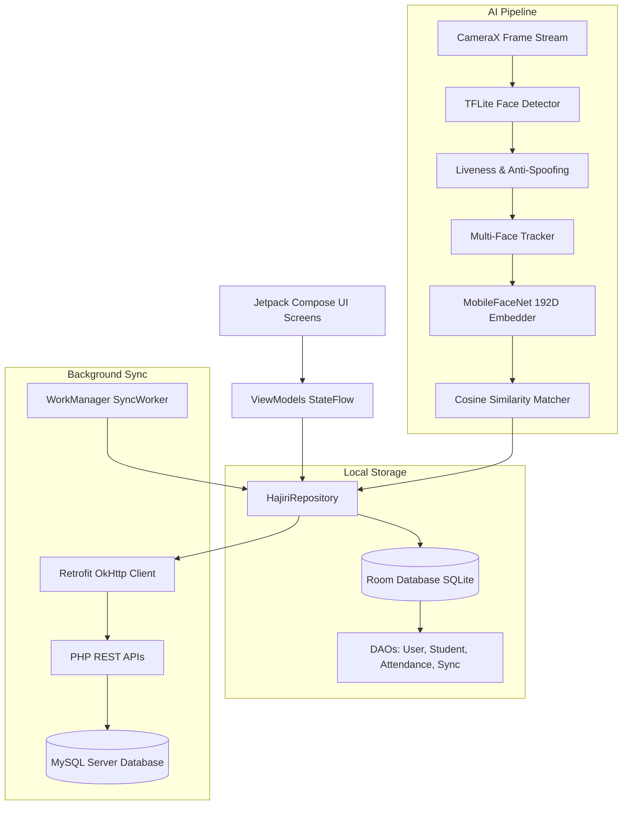
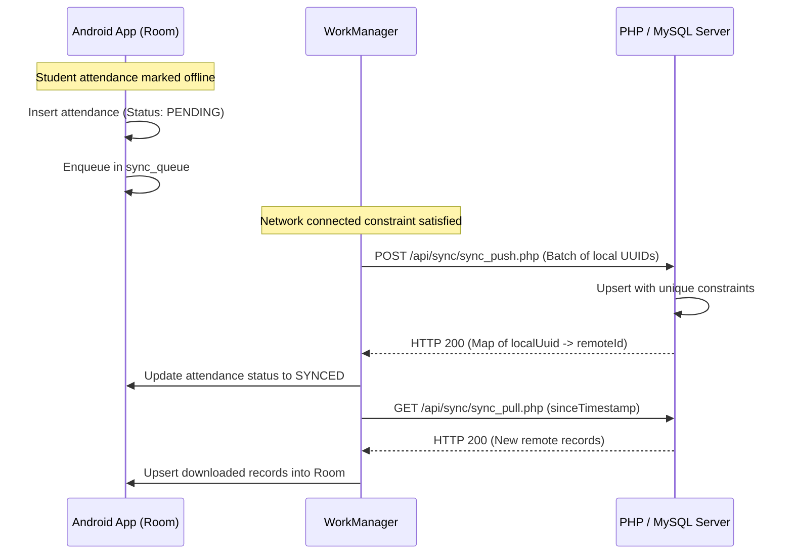

# HAJIRI BOOK – SYSTEM ARCHITECTURE

## 1. Architectural Overview
Hajiri Book follows Google's recommended **Clean Architecture** combined with **MVVM (Model-View-ViewModel)** and the **Repository Pattern**. The system is strictly **offline-first**: all UI interactions read from and write to the local Room database, while background workers handle network synchronization asynchronously.

---

## 2. Core Modules & Responsibilities

| Module | Location | Purpose |
| :--- | :--- | :--- |
| **Presentation** | `ui/screens/*`, `ui/components/*` | Jetpack Compose declarative UI conforming to Premium Blue + Green design system. |
| **State Management** | `viewmodel/*` | Holds reactive `StateFlow` state, handles coroutines, and interacts with the repository. |
| **Local Data** | `data/local/*` | Room Database entities, DAOs, and TypeConverters for persistent offline capability. |
| **AI Inference** | `ai/*`, `camera/*` | On-device face detection, anti-spoofing liveness, 192D embedding extraction, and cosine vector matching. |
| **Voice Speech** | `speech/TextToSpeechManager.kt` | Non-blocking bilingual (Hindi/English) student name announcement on successful attendance. |
| **Sync Engine** | `sync/*` | WorkManager jobs, exponential backoff, and local change queue. |
| **Security & Backup** | `security/encryption/*` | AES-256-GCM database export/restore and biometric data protection. |
| **Backend API** | `backend/*` | PHP 8 REST API with PDO prepared statements and JWT authentication. |
| **Server Database**| `database/hajiri_book.sql` | Production relational MySQL schema with indexing and unique constraints. |

---

## 3. Bidirectional Synchronization & Conflict Resolution

### Conflict Resolution Policy:
1. **Server Authority**: School metadata, class definitions, and administrator permissions are authoritative on the server.
2. **Device Authority**: Field attendance entries generated on authorized devices carry immutable local UUIDs; duplicate timestamps are resolved idempotently.
3. **Student Updates**: Conflicts during simultaneous edits are resolved using version/timestamp comparison, logging any discrepancy to `audit_logs`.

---

## 4. Biometric Privacy & Child Data Security
Biometric facial embeddings constitute sensitive personal data under applicable Indian Data Protection laws (DPDP Act):
1. **Never Transmit Raw Photos Unnecessarily**: Only numerical embedding vectors (192 floats) are stored or transmitted.
2. **Encrypted Backups**: Backups exported to storage are encrypted using AES-256 in GCM mode.
3. **Consent Workflow**: Explicit student/parental enrollment consent is tracked per student record.
4. **Data Deletion**: Deleting a student triggers a cascade delete across `student_face_templates` and removes associated embedding vectors immediately.
